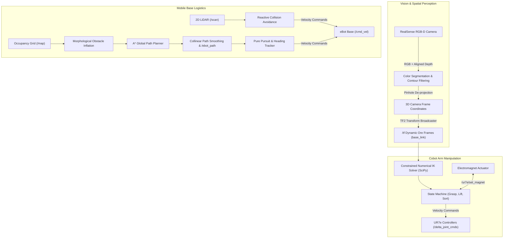
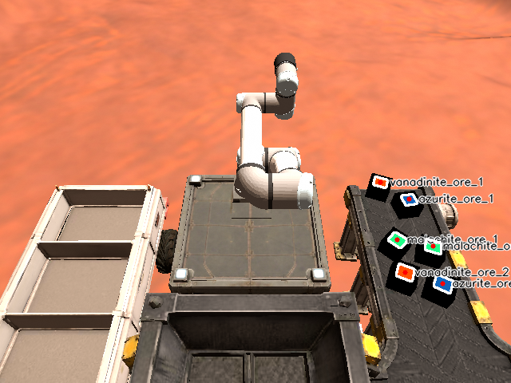

# e-Yantra Robotics Competition (eYRC 2026-27) — StrataCobot (SC)

<div align="center">

[](https://docs.ros.org/en/jazzy/)
[](https://gazebosim.org/)
[](https://www.python.org/)
[](https://opencv.org/)
[](https://ubuntu.com/)
[](LICENSE)

**Team ID:** `SC#4096` &nbsp;|&nbsp; **Theme:** `StrataCobot (SC)` &nbsp;|&nbsp; **Host:** e-Yantra, IIT Bombay

</div>

---

## 🚀 Project Overview

The **StrataCobot (SC)** theme in **eYRC 2026-27** simulates an end-to-end autonomous robotic mining and planetary logistics infrastructure on the surface of Mars (Kepler World). The mission integrates a **6-DOF UR7e Collaborative Robot (Cobot)** and an **Autonomous Mobile Robot (eBot)** working in tandem to harvest, sort, and transport critical extraterrestrial mineral ores.

This repository hosts the complete codebase, algorithms, perception pipelines, motion controllers, and evaluation packages developed by **Team SC#4096**.

---

## 🧠 System Architecture



---

## 🛠️ Task Breakdown & Technical Highlights

### 🔹 [Task 1A: 3D Multi-Spectral Ore Perception & TF2](task-1A-perception/)
- **Objective:** Detect and pinpoint six ore samples of three distinct types (`azurite_ore`, `malachite_ore`, `vanadinite_ore`) on a dynamic conveyor belt.
- **Computer Vision Pipeline:**
  - Multi-channel color thresholding optimized for Martian lighting conditions.
  - Morphological opening and area filtering to eliminate conveyor noise and shadow artifacts.
- **Spatial Transformation:**
  - De-projects 2D pixel centroids to 3D Cartesian points using RealSense optical intrinsics ($f_x, f_y, c_x, c_y$) and aligned depth.
  - Broadcasts dynamic spatial coordinates to `/tf` relative to the robot's `base_link` with ore height compensation.
- **Key Result:** 100% detection rate and sub-centimeter spatial localization accuracy.

<div align="center">
  
  <p><em>RealSense RGB-D Ore Segmentation & Centroid Tracking</em></p>
</div>

---

### 🔹 [Task 1B: UR7e Cobot Velocity Control & Waypoint Tracking](task-1B-cobot-control/)
- **Objective:** Command a 6-DOF UR7e cobot along 3D spatial waypoints with velocity limits and steady-state holding.
- **Highlights:**
  - Integrated with ROS 2 controller switching interface (`delta_twist_controller` and `delta_joint_controller`).
  - Closed-loop proportional Cartesian velocity controller running at 100 Hz.
  - Strict Cartesian velocity clamping ($\le 0.15 \text{ m/s}$ linear, $\le 0.35 \text{ rad/s}$ angular) and dead-man safety timeout watchdog (0.15s).
  - Enforced $\le 1.0 \text{ cm}$ positional tolerance with mandatory 2.0-second waypoint station-keeping.

---

### 🔹 [Task 1C: eBot Trajectory Tracking & Reactive Collision Avoidance](task-1C-ebot-navigation/)
- **Objective:** Navigate an autonomous differential-drive eBot across winding waypoint tracks while avoiding terrain obstacles.
- **Highlights:**
  - Matched `TRANSIENT_LOCAL` QoS subscription for latched global trajectory paths (`/ebot_path`).
  - Continuous heading orientation alignment and Pure Pursuit velocity modulation ($v_{\max} = 0.5 \text{ m/s}$, $\omega_{\max} = 1.0 \text{ rad/s}$).
  - Real-time 2D LiDAR laser scan processing across forward sectors with obstacle avoidance steering injection.

---

### 🔹 [Task 2A: Integrated Vision-Guided Cobot Manipulation & Sorting](task-2A-perception-manipulation/)
- **Objective:** Autonomous identification, pick-and-place, and sorting of mineral ores from the conveyor into respective classification bins.
- **Highlights:**
  - **Optimization-Based Numerical IK:** Developed a custom inverse kinematics solver using SciPy optimization (`minimize` with joint boundary constraints) to guarantee reachability and prevent kinematic singularities.
  - **Closed-Loop Joint Space Control:** High-frequency joint jogging via `/delta_joint_cmds` with encoder feedback from `/joint_states`.
  - **Electromagnetic Grasping:** Actuation synchronization with `/ur7e/set_magnet` service and contact confirmation via end-effector force feedback (`/ur7e/end_effector/force_magnitude`).
  - **Finite State Machine:** Robust transit corridors (Home $\to$ Pre-Grasp $\to$ Grasp $\to$ Lift $\to$ Bin Transport $\to$ Release $\to$ Return).

---

### 🔹 [Task 2B: Global Grid Path Planning & Autonomous Colony Logistics](task-2B-autonomous-planning-navigation/)
- **Objective:** Full-scale autonomous colony logistics: computing optimal global routes across large Martian occupancy grids and transporting ore packages between mining stations.
- **Highlights:**
  - **Morphological Obstacle Inflation:** Custom OpenCV dilation filter applied to 2D costmaps, guaranteeing safe clearance around hazardous rock formations.
  - **A\* Shortest Path Algorithm:** 8-connected grid graph search with Euclidean heuristic, generating optimal trajectories in under 200 ms.
  - **Collinear Path Pruning:** Smoothes raw discrete grid paths into clean, continuous waypoints.
  - **Service-Triggered Mission Coordination:** Autonomous payload handover using `/spawn_ore_package` service client.

---

## 💡 Engineering Challenges Solved

1. **Martian Soil vs. Ore Color Interference:**
   - *Problem:* Vanadinite ore exhibits red-orange tones very similar to the surrounding Martian terrain, causing false positives with standard RGB thresholding.
   - *Solution:* Implemented a dual-channel ratio filter that tests $(R > 175) \land (30 < G < 135) \land (B < 40)$, isolating pure mineral luminescence from soil background scattering.

2. **Kinematic Singularities & Out-of-Reach Discontinuities:**
   - *Problem:* Analytical closed-form IK for 6-DOF arms often produced joint-wrap discontinuities or tried to cross singular configurations near workspace boundaries.
   - *Solution:* Formulated inverse kinematics as a constrained objective minimization problem initialized from current joint poses, resulting in smooth, deterministic joint motions.

3. **High-Rate Safety Watchdog Compliance:**
   - *Problem:* The cobot controller drops entire command frames if any velocity component exceeds hardware limits or if communication latency exceeds 150 ms.
   - *Solution:* Designed a rate-controlled publisher running at 100 Hz with strict proportional vector clamping, ensuring non-jittery motion and compliance with the cobot's dead-man switch.

---

## 📂 Repository Structure

```
eyantra-stratacobot/
├── LICENSE                                     # MIT License
├── README.md                                   # Master Project Documentation
├── assets/
│   └── ore_detection_sample.png                # RealSense RGB-D detection snapshot
├── task-1A-perception/
│   ├── README.md                               # Detailed Task 1A documentation
│   ├── ore_detector.py                         # 3D Perception & TF2 node
│   └── result.zip                              # Official submission package
├── task-1B-cobot-control/
│   ├── README.md                               # Detailed Task 1B documentation
│   ├── arm_waypoints.py                        # UR7e Cartesian velocity controller
│   └── result.zip                              # Official submission package
├── task-1C-ebot-navigation/
│   ├── README.md                               # Detailed Task 1C documentation
│   ├── ebot_nav.py                             # eBot trajectory tracking & avoidance
│   └── result.zip                              # Official submission package
├── task-2A-perception-manipulation/
│   ├── README.md                               # Detailed Task 2A documentation
│   ├── task2A_perception.py                    # Multi-ore vision detection node
│   ├── task2A_manipulation.py                  # Pick-and-place manipulation state machine
│   └── result.zip                              # Official submission package
└── task-2B-autonomous-planning-navigation/
    ├── README.md                               # Detailed Task 2B documentation
    ├── task2B_planning.py                      # A* grid path planner & service client
    ├── task2B_navigation.py                    # Autonomous mobile navigation node
    └── result.zip                              # Official submission package
```

---

## 💻 Tech Stack & Environment

| Component | Specification |
|---|---|
| **Operating System** | Ubuntu 24.04 LTS (Noble Numbat) |
| **Robotics Middleware** | ROS 2 Jazzy Jalisco |
| **Physics Simulator** | Gazebo Harmonic |
| **Programming Language** | Python 3.12 |
| **Vision Libraries** | OpenCV 4.x, NumPy |
| **Scientific Computing** | SciPy (SLSQP / Numerical Optimization) |
| **Coordinate Transforms** | `tf2_ros`, `tf2_geometry_msgs` |
| **Robot Platforms** | Universal Robots UR7e Cobot & eBot Mobile Platform |

---

## 🏃 Reproduction & Setup

### 1. Prerequisites
Ensure you have **ROS 2 Jazzy** installed with simulation dependencies:
```bash
sudo apt update
sudo apt install -y ros-jazzy-desktop python3-colcon-common-extensions \
                    ros-jazzy-cv-bridge ros-jazzy-tf2-ros \
                    ros-jazzy-tf2-geometry-msgs ros-jazzy-control-msgs
pip install opencv-python numpy scipy
```

### 2. Build in ROS 2 Workspace
Copy the desired scripts into your ROS 2 workspace `src/algorithms/scripts`:
```bash
cd ~/ros2_ws
colcon build --symlink-install
source install/setup.bash
```

### 3. Running Tasks
Launch the Kepler simulation world and start the corresponding node:
```bash
# Example: Running Task 2B
ros2 launch eyantra_kepler_colony task2b.launch.py

# In separate terminals:
ros2 run algorithms task2B_planning.py
ros2 run algorithms task2B_navigation.py
```

---

## 👥 Authors & Team Credits

**Team SC#4096**
- **Abhinav Reddy**
- **Aditya M.**
- **Siddarth**
- **Dinesh**

*Organized by **e-Yantra (IIT Bombay)**, funded by MoE, Government of India.*
