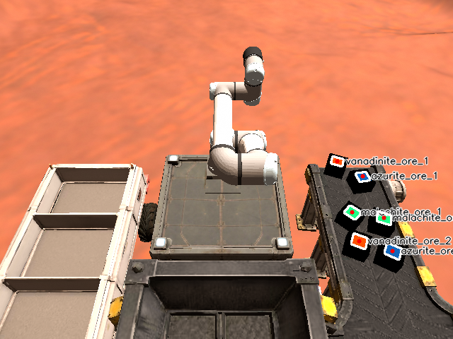

# Task 1A: 3D Multi-Spectral Ore Perception & TF2 Broadcast

## Overview
Task 1A implements an end-to-end computer vision and spatial coordinate transformation pipeline for detecting, identifying, and localizing Martian mineral ores on a dynamic conveyor belt in the simulated Kepler colony environment.

## Key Technical Highlights
- **RGB Color Thresholding & Morphological Cleaning:** Custom color space thresholding designed to reliably segment three distinct ore types:
  - **Azurite Ore:** High Blue dominance, attenuated Red.
  - **Malachite Ore:** High Green dominance, low Red.
  - **Vanadinite Ore:** High Red with tuned Green and minimized Blue to prevent false positives against the Martian red soil.
  - Morphological opening (`cv2.MORPH_OPEN`) and external contour detection with area filtering ($40 < \text{Area} < 1500$) to reject conveyor belt artifacts and specular noise.
- **2D-to-3D Pinhole Camera De-projection:**
  De-projects 2D pixel coordinates $(u, v)$ to 3D Cartesian coordinates $(X_c, Y_c, Z_c)$ in the camera optical frame using pinhole camera intrinsic parameters $(f_x, f_y, c_x, c_y)$ and aligned RealSense depth:
  $$X_c = \frac{(u - c_x) \cdot Z}{f_x}, \quad Y_c = \frac{(v - c_y) \cdot Z}{f_y}, \quad Z_c = Z$$
- **Dynamic Coordinate Frame Transformation (TF2):**
  Uses `tf2_ros` to transform the calculated 3D coordinates from the camera optical frame into the universal robot frame (`base_link`), accounting for ore centroid elevation offset and publishing real-time dynamic transforms to `/tf`.

## Topics & Interfaces
| Type | Topic Name | Message Type |
|---|---|---|
| Sub | `/camera/camera/color/image_raw` | `sensor_msgs/msg/Image` |
| Sub | `/camera/camera/aligned_depth_to_color/image_raw` | `sensor_msgs/msg/Image` |
| Sub | `/camera/camera/color/camera_info` | `sensor_msgs/msg/CameraInfo` |
| Pub | `/tf` | `tf2_msgs/msg/TFMessage` |
